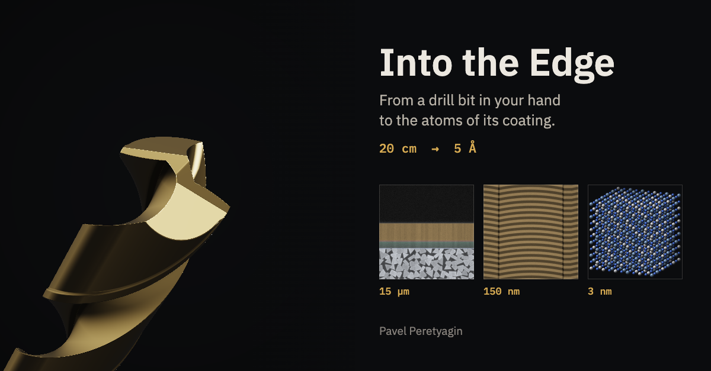

# Into the Edge

**From palm to atom.** Scroll, swipe or pinch and dive from a gold-coated drill bit in the palm of your hand down to the atoms of its coating: almost nine orders of magnitude, from 20 cm to 5 Å. Every level has one plain-language caption, a familiar object drawn at true scale for comparison, and a card for researchers with the method used at that scale and an open question.

Live: https://peretyaginmstu-jpg.github.io/into-the-edge/



## The path

| # | Field of view | On screen | For comparison |
| --- | --- | --- | --- |
| 0 | 20 cm | The drill bit, Ø 8 mm, lying on an outlined palm | Hand |
| 1 | 2 cm | The tip, its two cutting edges and the flutes | — |
| 2 | 0.5 mm | The corner of a cutting edge, smoothly rounded | Human hair, 60–80 µm |
| 2b | 100 µm | A gallium-ion beam mills a pit into the edge; the camera goes down into it and turns to the cut wall | Human hair |
| 3 | 15 µm | Cross-section in the style of a scanning electron microscope: the coating on cemented carbide | Red blood cell, about 8 µm |
| 4 | 2 µm | Columnar grains of the coating | E. coli, 2 µm |
| 5 | 150 nm | Alternating nanolayers, in the style of a transmission electron microscope | Influenza virus, 80–120 nm |
| 6 | 3 nm | A block of the NaCl-type lattice of Ti, Al and N, cell about 0.42 nm; drag to turn it | DNA double helix, 2 nm |
| 7 | 5 Å | One cell, its atoms glowing softly and vibrating | Water molecule, 0.28 nm |

The cross-section follows the author's PVD coating architecture, 4.0 µm in total: (AlCrTiNbV)N 2.7 µm, transition zone 0.2 µm, TiCrAlSiN 1.0 µm (graded), Ti (Cr) 0.1 µm, on cemented carbide (tungsten carbide grains in cobalt). The shank of the tool is left uncoated.

All images are scientific illustrations generated in the browser with fixed random seeds, not photographs or micrographs. Every caption, number and comparison size comes from the sources listed below.

## How it works

- The whole view is a function of one number: `z = log10(field of view in metres)`. The field of view is the shorter side of the screen, so the scale bar and the comparison objects always agree with each other.
- Wheel, trackpad, pinch, swipe and the arrow keys change `z` smoothly, with inertia; `PageDown`/`PageUp` or `Space` jump between levels. The ruler on the right jumps to a level on click and scrubs on drag. The address keeps the level (`#level-5`, `#end`).
- `Play` flies through the whole path with a pause at every level; `Restart` returns to the hand; `EN/RU` switches the language (English by default, Russian from the browser language); `Share` uses the system share sheet or copies the link.
- With `prefers-reduced-motion` there is no inertia and no automatic camera flight: the view cuts from level to level.
- Three scenes share one WebGL context (three.js):
  - **drill** (levels 0–2b) is ray-marched: a signed distance field of a solid carbide twist drill with twisted flutes, margins, a four-facet 140° point and honed edges, plus the ion-beam pit milled pass by pass;
  - **section** (levels 3–5) is a procedural electron-microscope picture of the cross-section, from SEM to Z-contrast STEM, down to rows of atomic columns;
  - **lattice** (levels 6–7) draws the atoms as ray-traced impostor spheres.
  Inner levels are born at the anchor of the outer one and the scenes hand over where they show the same thing: the pit wall becomes the flat section, the STEM atom columns become the 3D crystal.
- Resolution adapts to keep the frame rate up (`?debug=1` shows frames per second and the current quality).
- Static site without a build step: HTML, CSS and JavaScript modules. three.js r186 is vendored in `vendor/three/`, IBM Plex Sans and Mono (Latin and Cyrillic) in `fonts/`. The first load is about 1.0 MB (0.35 MB compressed).

## Video for the post

Open `?record=1&ratio=4x5` (also `1x1`, `9x16`, `16x9`; add `&lang=ru` for Russian). The interface disappears and the camera flies the whole path in about 52 seconds with a three-second pause at each level, captions in large type, 1080×1350.

- To record the screen, press `Space` (or `Play`) and record the frame.
- To save the video directly, press `R` (or `Record video`): every frame is rendered at a fixed 60 fps and encoded to H.264 MP4 with WebCodecs, independent of the speed of the machine (it takes a few seconds). Browsers without WebCodecs fall back to real-time capture.
- Options: `&fps=30`, `&hold=3` (seconds per level), `&autoplay=0`.

## Run it locally

```
python3 tools/serve.py
```

Then open http://localhost:8790. Any static server works; `tools/serve.py` also accepts `POST /__save?name=...` so that snapshots and videos can be written into `exports/` (see `js/engine/snapshot.js`).

## Project layout

```
index.html              page shell
css/style.css           layout and type
js/main.js              picks the journey (?journey=drill) and starts the engine
js/engine/              the engine: zoom state and input, compositor, overlay, UI, i18n,
                        comparison shapes, video mode, MP4 writer, snapshots
js/scenes/              drill (ray marching), section (SEM/STEM), lattice, placeholder
journeys/drill.js       this journey: levels, comparison objects, scenes, sources
i18n/en.json, ru.json   all texts
vendor/three/           three.js (MIT)
fonts/                  IBM Plex (SIL OFL 1.1)
og.png                  link preview, 1200×627
tools/serve.py          local preview server
```

## Make your own journey

The engine knows nothing about drills. A journey is one config file plus texts, so another lab can build the same kind of zoom for its own material (a zirconia crown, a battery electrode, a turbine blade).

1. **Copy `journeys/drill.js` to `journeys/<name>.js`** and open the site with `?journey=<name>`.
2. **Levels (`stops`).** Each stop has an `id`, a field of view `fov: [value, unit]` (units `m`, `cm`, `mm`, `um`, `nm`, `A`), the `sources` that support its caption, and `card`, the sources of its researcher card. `transition: true` marks an in-between stop without a card. `finalStretch` is the extra scroll, in decades, that reveals the final screen.
3. **Texts.** Add a block named after the journey `id` to `i18n/en.json` and `i18n/ru.json`: `levels.<id>.name` and `.caption`, `cards.<id>.method` and `.question`, `compare.<label>`, `final.text` and `final.author`. Engine texts live under `ui`. Sources can be translated under `<id>.sources.<key>`.
4. **Comparison objects (`comparisons`).** `shape` is one of `hair`, `rbc`, `ecoli`, `virus`, `dna`, `water` (see `js/engine/shapes.js`, add your own there), `size` is the true size it is drawn at, `stops` the levels it accompanies, `at` its place inside the square reference frame (0–1), with optional `atPortrait`, `angle`, `labelAt`.
5. **Scenes.** Each entry names a module and the range of `z` where it is drawn, `[outer, inner]`; an inner scene fades in over `fadeIn`. Start with `js/scenes/placeholder.js`, which draws nested frames docked at anchors, then replace it. A scene is a class with:
   - `constructor({ THREE, renderer, journey, spec, params, seed, app })` and an optional async `init()`;
   - `update(view, layer)`: `view` holds `z`, `fov` (m), `pxPerM`, `w`, `h`, `ref`, `t`, `final`, `reduced`; `layer` holds the render-target size;
   - `render(renderer)`: draws into the bound render target;
   - optional: `resolutionScale(quality, w, h)`, `needsDepth`, `isAnimating(view)`, `overlay(ctx, view, opacity, { label, t })` for 2D annotations, `rotatable(view)` and `rotate(dx, dy)` for drag rotation, `warmup(renderer)`.
6. **Fixed seeds.** Use `createRng` and `subSeed` from `js/engine/rng.js` (or hash functions in GLSL) seeded from `journey.seed`, so the pictures are identical on every visit.
7. **Preview images and video.** `snapshot(app, { z, width, height, save })` from `js/engine/snapshot.js` renders any point of the path; `?record=1` gives the video.

## Sources

Each entry was checked against the publisher's site, Crossref or an open copy of the paper. The list is reproduced from the project brief without changes.

1. Abrikosov I.A. et al. (2011) Phase stability and elasticity of TiAlN. Materials 4(9), 1599–1618. [doi:10.3390/ma4091599](https://doi.org/10.3390/ma4091599)
2. Alling B., Odén M., Hultman L., Abrikosov I.A. (2009) Pressure enhancement of the isostructural cubic decomposition in Ti1−xAlxN. Appl. Phys. Lett. 95, 181906. [doi:10.1063/1.3256196](https://doi.org/10.1063/1.3256196)
3. Anders A. (2010) A structure zone diagram including plasma-based deposition and ion etching. Thin Solid Films 518(15), 4087–4090. [doi:10.1016/j.tsf.2009.10.145](https://doi.org/10.1016/j.tsf.2009.10.145)
4. Arrazola P.J. et al. (2013) Recent advances in modelling of metal machining processes. CIRP Annals 62(2), 695–718. [doi:10.1016/j.cirp.2013.05.006](https://doi.org/10.1016/j.cirp.2013.05.006)
5. Batatia I. et al. (2022) MACE: Higher order equivariant message passing neural networks for fast and accurate force fields. NeurIPS 35, 11423–11436. [arXiv:2206.07697](https://arxiv.org/abs/2206.07697)
6. Berg G., Grau P. (1993) Influence of the substrate hardness on the validity of Bückle's rule. Cryst. Res. Technol. 28(7), 989–994. [doi:10.1002/crat.2170280722](https://doi.org/10.1002/crat.2170280722)
7. BioNumbers, записи 100798 (эритроцит), 102065 (кишечная палочка), 103723 (молекула воды). [bionumbers.hms.harvard.edu](https://bionumbers.hms.harvard.edu/bionumber.aspx?id=100798)
8. Bowler D.R., Miyazaki T. (2012) O(N) methods in electronic structure calculations. Rep. Prog. Phys. 75, 036503. [doi:10.1088/0034-4885/75/3/036503](https://doi.org/10.1088/0034-4885/75/3/036503)
9. Bull S.J., Berasetegui E.G. (2006) An overview of the potential of quantitative coating adhesion measurement by scratch testing. Tribol. Int. 39(2), 99–114. [doi:10.1016/j.triboint.2005.04.013](https://doi.org/10.1016/j.triboint.2005.04.013)
10. Dabees S. et al. (2022) Characterization and evaluation of engineered coating techniques for different cutting tools: review. Materials 15, 5633. [doi:10.3390/ma15165633](https://doi.org/10.3390/ma15165633)
11. Deng B. et al. (2023) CHGNet as a pretrained universal neural network potential for charge-informed atomistic modelling. Nat. Mach. Intell. 5, 1031–1041. [doi:10.1038/s42256-023-00716-3](https://doi.org/10.1038/s42256-023-00716-3)
12. Deng B. et al. (2025) Systematic softening in universal machine learning interatomic potentials. npj Comput. Mater. 11, 9. [doi:10.1038/s41524-024-01500-6](https://doi.org/10.1038/s41524-024-01500-6)
13. Denkena B., Biermann D. (2014) Cutting edge geometries. CIRP Annals 63(2), 631–653. [doi:10.1016/j.cirp.2014.05.009](https://doi.org/10.1016/j.cirp.2014.05.009)
14. García J. et al. (2019) Cemented carbide microstructures: a review. Int. J. Refract. Met. Hard Mater. 80, 40–68. [doi:10.1016/j.ijrmhm.2018.12.004](https://doi.org/10.1016/j.ijrmhm.2018.12.004)
15. Giannuzzi L.A., Stevie F.A. (1999) A review of focused ion beam milling techniques for TEM specimen preparation. Micron 30(3), 197–204. [doi:10.1016/S0968-4328(99)00005-0](<https://doi.org/10.1016/S0968-4328(99)00005-0>)
16. Helmersson U. et al. (1987) Growth of single-crystal TiN/VN strained-layer superlattices with extremely high mechanical hardness. J. Appl. Phys. 62(2), 481–484. [doi:10.1063/1.339770](https://doi.org/10.1063/1.339770)
17. ISO 14577-4:2016. Instrumented indentation test, part 4: test method for metallic and non-metallic coatings. [iso.org](https://www.iso.org/standard/61823.html)
18. Mayrhofer P.H. et al. (2003) Self-organized nanostructures in the Ti–Al–N system. Appl. Phys. Lett. 83(10), 2049–2051. [doi:10.1063/1.1608464](https://doi.org/10.1063/1.1608464)
19. Melkote S.N. et al. (2017) Advances in material and friction data for modelling of metal machining. CIRP Annals 66(2), 731–754. [doi:10.1016/j.cirp.2017.05.002](https://doi.org/10.1016/j.cirp.2017.05.002)
20. Noda T. (2012) Native morphology of influenza virions. Front. Microbiol. 2, 269. [doi:10.3389/fmicb.2011.00269](https://doi.org/10.3389/fmicb.2011.00269)
21. Norrby N., Johansson M.P., M'Saoubi R., Odén M. (2012) Pressure and temperature effects on the decomposition of arc evaporated Ti0.6Al0.4N coatings in continuous turning. Surf. Coat. Technol. 209, 203–207. [doi:10.1016/j.surfcoat.2012.08.068](https://doi.org/10.1016/j.surfcoat.2012.08.068)
22. Petrov I., Barna P.B., Hultman L., Greene J.E. (2003) Microstructural evolution during film growth. J. Vac. Sci. Technol. A 21(5), S117–S128. [doi:10.1116/1.1601610](https://doi.org/10.1116/1.1601610)
23. Teti R., Jemielniak K., O'Donnell G., Dornfeld D. (2010) Advanced monitoring of machining operations. CIRP Annals 59(2), 717–739. [doi:10.1016/j.cirp.2010.05.010](https://doi.org/10.1016/j.cirp.2010.05.010)
24. Walter AG. Патенты US 7,758,975 B2 (2010) и US 9,476,114 B2 (2016) о тонком золотистом верхнем слое для заметности износа. [patents.google.com](https://patents.google.com/patent/US7758975B2/en)
25. Watson J.D., Crick F.H.C. (1953) Molecular structure of nucleic acids. Nature 171, 737–738. [doi:10.1038/171737a0](https://doi.org/10.1038/171737a0)
26. Wolfram L.J. (2003) Human hair: a unique physicochemical composite. J. Am. Acad. Dermatol. 48(6 Suppl), S106–S114. [doi:10.1067/mjd.2003.276](https://doi.org/10.1067/mjd.2003.276)

## Licences

- Code: MIT, see [LICENSE](LICENSE).
- Texts and illustrations: CC BY 4.0, see [LICENSE-CONTENT.md](LICENSE-CONTENT.md).
- three.js: MIT, see `vendor/three/LICENSE`. IBM Plex: SIL Open Font License 1.1, see `fonts/LICENSE-OFL.txt`.

## Author

Pavel Peretyagin · [GitHub](https://github.com/peretyaginmstu-jpg)

